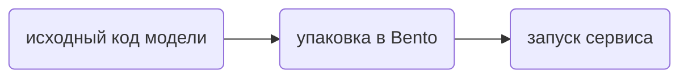

# Bentoml вебинарный проект от Deepschool.

Проект подготовлен для вебинара по [BentoML](https://github.com/bentoml/BentoML) и демонстрирует создание и упаковку Python‑модели как сервиса ML‑сервера.

[Репозиторий](https://gitlab.com/AnnGareeva/bentoml_vebinar/-/blob/bento_v0.2/service.py?ref_type=heads)

[Данные и веса модели](https://www.dropbox.com/scl/fo/zzdyf4g662e55dae76pf3/AOtAYFbDtgckDXTuY33zq6M?rlkey=s0mp5k9euuedowuszrpyewcqp&e=5&st=y0whfsak&dl=0)

---

## Описание

Этот репозиторий содержит:

- Python‑скрипт с моделью Unet сегментаторов (smp);  
- service.py -- класс сервиса BentoML;
- request_example -- пример с запросом на обработку.

Цель проекта — показать базовый workflow: 


---

## Требования

- Python 3.11
- pip (или pipenv/poetry/uv/conda/pixi)  
- [BentoML](https://docs.bentoml.com/)  
- (опционально) Docker, если планируется образ для контейнера.

---

## Установка

1. Клонируйте репозиторий:

   ```bash
   git clone https://gitlab.com/AnnGareeva/bentoml_vebinar.git
   cd bentoml_vebinar
   ```

2. Создайте окружение и установите необходимые зависимости

    ```bash
    python3.11 -m venv .venv
    source .venv/bin/activate
    pip install -r req.txt
    ```

3. Скачайте веса и примеры данных:
    <https://www.dropbox.com/scl/fo/zzdyf4g662e55dae76pf3/AOtAYFbDtgckDXTuY33zq6M?rlkey=s0mp5k9euuedowuszrpyewcqp&e=1&st=y0whfsak&dl=0>

4. Запустите сервис
    `bentoml serve` — точку входа (`service:PlantSegmentator`)

5. Проверьте, что сервис работает корректно, запустив отдельно скрипт `request_example.py` (подробнее в разделе «Проверка результата»)

Также можете воспользоваться Swagger через localhost:3000

## Проверка результата

Пока сервис запущен (локально через `bentoml serve` или в контейнере с `-p 3000:3000`), в другом терминале выполните:

```bash
python request_example.py
```

Скрипт по шагам:

1. проверяет `/readyz` — модель загружена и сервис готов принимать запросы;
2. проверяет `/livez` — процесс сервиса жив;
3. запрашивает версию модели через `get_model_version`;
4. отправляет контрольный пример `data/inimages/T02_Box051_2017-10-31T11-51-17-647_19.png` и проверяет маску;
5. сохраняет бинарную маску (порог `0.5`) в `T02_Box051_2017-10-31T11-51-17-647_19_bento_res.png`.

При ошибке скрипт пишет, какая проверка не прошла, и завершается с кодом 1, маска при этом не сохраняется.

## Сборка Bento с помощью bentoml build

1. Клонируйте репозиторий:

   ```bash
   git clone https://gitlab.com/AnnGareeva/bentoml_vebinar.git
   cd bentoml_vebinar
   ```

2. Создайте новое окружение и установите bentoml

    ```
    pip install bentoml
    ```

3. Для упаковки сервиса в Bento используйте команду:

    ```bash
    bentoml build
    ```

4. Далее запустите `bentoml containerize <tag>`
5. После успешной сборки необходимо запустить

    ```
    docker run -ti --rm -p 3000:3000 <tag>
    ```

**ИЛИ**

1. Клонируйте репозиторий:

   ```bash
   git clone https://gitlab.com/AnnGareeva/bentoml_vebinar.git
   cd bentoml_vebinar
   ```

2. Положите `checkpoint.pth` в корень проекта: веса копируются в образ. Что не попадает в образ, задаёт `.dockerignore`.

3. Для упаковки сервиса в Docker используйте команду:

    ```bash
    docker build . --tag bento_veb
    ```

4. После успешной сборки необходимо запустить

    ```
    docker run  --rm -p 3000:3000 bento_veb:latest
    ```
